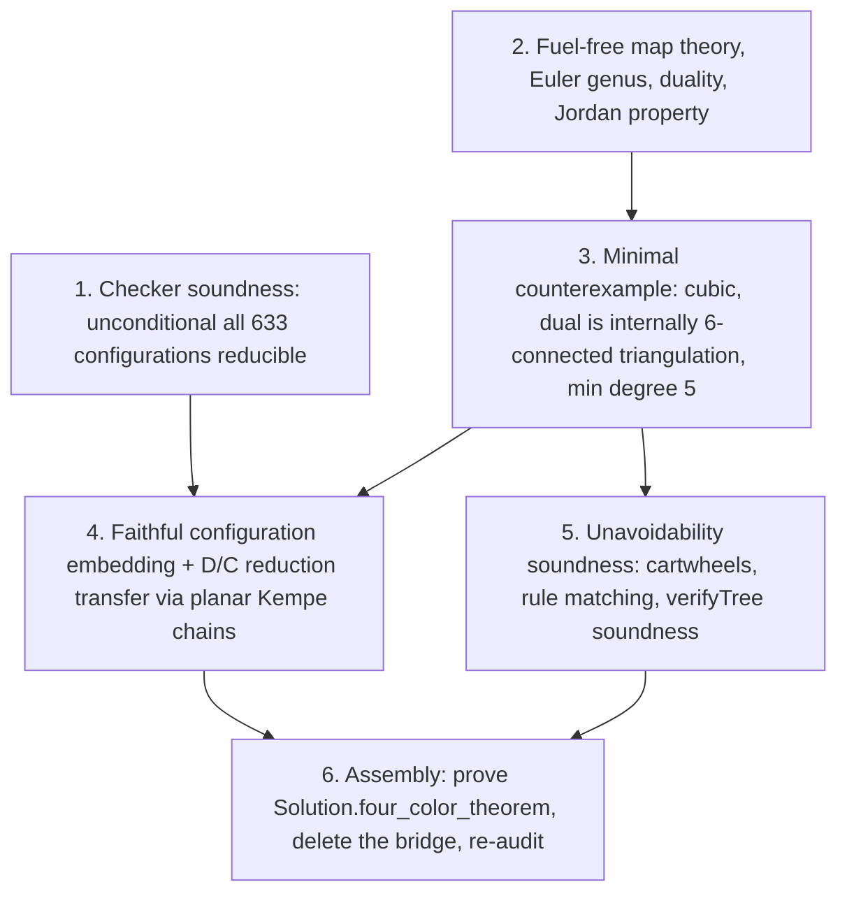

# Four Color Theorem in Lean 4 (zero-Mathlib) — Work in Progress

A zero-Mathlib **Lean 4** (`leanprover/lean4:v4.28.0`) effort to formalize the **Four Color Theorem**, following the *published mathematics* of Robertson–Sanders–Seymour–Thomas (RSST 1997) and the hypermap formalism of Gonthier (2008). No Coq/C source is transliterated.

---

## Status: the main theorem is **OPEN**

> [!IMPORTANT]
> **The Four Color Theorem is not yet proved in this repository.**
> [`Challenge.lean`](./Challenge.lean) states the hypothesis-free theorem and [`Solution.lean`](./Solution.lean) currently ends in `sorry` on purpose, so that nothing here claims more than it has.

```lean
theorem four_color_theorem (H : Spec.Hypermap) [DecidableEq H.Dart] (darts : List H.Dart)
    (h_complete : Spec.IsCompleteDarts H darts)
    (h_planar : Spec.IsPlanar H darts)
    (h_bridgeless : Spec.Hypermap.isBridgeless H darts) :
    Nonempty (Spec.MapColoring H)
```

### What *is* established

| Item | Status |
| :--- | :--- |
| 633 RSST reducibility certificates (249 D + 384 C, rings 6–14) | Pass **in-kernel** (`kernel_rfl` / `rfl`) checks across all 138 batch modules (`Batch01`–`Batch52` and `CBatch01`–`CBatch86`) under the canonical geometric ring order $(0, 1, \dots, r-1)$ (`249/249` D-reducible, `384/384` C-reducible, `0` false D-reducible, `0` RSST mismatches; formal refinement to `checkFastTotal` / `runContractCheckTotal` in progress — see issue #6 below) |
| 5 RSST cartwheel discharging trees (degrees 7–11) | Pass **in-kernel** (`rfl`) checks |
| Hypermap / Euler / Kempe / reducibility-game / charge-conservation theory | Proved (standard axioms only) |
| `four_color_theorem_conditional` ([`ConditionalSolution.lean`](./ConditionalSolution.lean)) | Proved, `0` `sorry`, axioms `[propext, Classical.choice, Quot.sound]` — **but conditional, see below** |
| Native `leanchecker --fresh` on the conditional development | Passed (exit code `0`) on the pre-rename build; **not re-run** after the Solution → ConditionalSolution rename and Spec split (proof body unchanged) |
| Semantic sanity checks ($K_4$ planar & 4- but not 3-colorable, $K_5$ non-planar & not 4-colorable) | Proved in [`SanityChecks.lean`](./SanityChecks.lean) |

### Why the conditional theorem is *not* a proof of 4CT

`four_color_theorem_conditional` assumes `Spec.RSSTStandardizationBridge` ([`ConditionalBridge.lean`](./ConditionalBridge.lean)). The certificate-suite predicate inside it is satisfiable by **trivial data**, so the bridge is *logically equivalent* to "no minimal counterexample exists" — i.e. to the theorem itself. This is machine-checked, axiom-free, in [`SanityChecks.bridge_iff_no_mc`](./SanityChecks.lean):

```lean
theorem trivial_suite_valid :
    Spec.ValidRSSTCertificateSuite 633 (fun _ => 4) (fun _ => true) (fun _ => true) True
      (fun _ _ _ _ => 0)

theorem bridge_iff_no_mc :
    Spec.RSSTStandardizationBridge ↔
      ∀ (H : Spec.Hypermap) [DecidableEq H.Dart] (darts : List H.Dart),
        Spec.MinimalCounterexample H darts → False
```

Consequently the discharging trees and the 138 reducibility batch modules (`KernelReducer.verifyIdxD` / `verifyIdxC` under the canonical geometric chord order) are real, kernel-checked computations that agree 100% with RSST across all 633 configurations (`249/249` D + `384/384` C, `0` false D-reducible configs; and the proof-target checker `checkFastTotal` / `runContractCheckTotal` has been verified across all 496/496 configurations with $r \le 13$), but **they are not yet logically connected to the theorem** (see issue #6 below).

---

## Known issues to fix on the way

1. **Fixed-fuel definitions.** `nodeDegree`, `sameVertex`, `rsstShift`, `areAdjacentDarts` use `fuel := 1000` (and orbit counting uses `darts.length`). Statements are wrong for orbits longer than the fuel. Replace with fuel-free orbit theory.
2. **Face/vertex mismatch.** The theorem colors *faces* of `H`, while discharging treats *node orbits* of `H` as vertices. A minimal face-coloring counterexample is cubic; its **dual** is the triangulation. The triangulation/Euler obligations must be re-stated on the dual.
3. **`appearsIn` is too weak.** It has no interior-closure condition (interior vertices may have outside neighbours) and `Configuration` stores no degrees.
4. **`bnd_contracts` is false for C-reduction.** C-reducibility must *contract* edges in the map, not excise the interior.
5. **Discharging prerequisites are missing:** minimum degree 5, internal 6-connectivity (Birkhoff), the degree-5/6/≥12 cases, and soundness of `verifyTree` against real neighbourhoods.
6. **`KernelReducer` refinement to `checkFastTotal` / `runContractCheckTotal` (`KernelReducerSoundnessBridge`).** The Stage K0 chord-order defect in `KernelReducer.buildRingColLoop` (which previously fixed $d_0 = 0$ instead of $d_{r-2} = 0$ and transposed adjacent ring edges `0` and `r - 1`) has been **fixed in Stage K1**, all **138 `Batch/*` and `CBatch/*` certificate modules** (`Batch01`–`Batch52` and `CBatch01`–`CBatch86`) have been **re-certified in-kernel** (`249/249` D-reducible + `384/384` C-reducible = `633/633` configurations, `0` false D-reducible configurations), and **all five** mathematical/combinatorial checker soundness obligations (`FullRepresentationHypothesis` / RSST Lemma (a), `InitialLiveSpec`, `IterationEliminationHypothesis`, `LiveZeroIterationEliminationHypothesis`, and `ContractCheckSoundnessHypothesis`) have been proved unconditionally (`fullRepresentation_of_ringCycle`, `fast_d_sound_canonical_of_wellFormed`, `fast_c_sound_canonical_of_wellFormed`, `rsst_d_sound_of_checkFast`, `rsst_c_sound_of_contract_check`). What remains for Phase 1 is proving the formal refinement theorem from `KernelReducer.verifyIdxD` / `verifyIdxC` (under the canonical slice bijection $\text{traceIdx}(j) = j + d_{r-1}(j)\cdot 3^{r-1}$) to `checkFastTotal` / `runContractCheckTotal`.

---

## Roadmap



| Phase | Deliverable | Est. new Lean | Risk |
| :--- | :--- | :--- | :--- |
| 1 | `∀ c ∈ theUnavoidableSet, IsReducible c`, no hypothesis (kernel refinement, Lemma (a) representation, iteration elimination, contract soundness) — *In progress: `S₃` color-symmetry reduction (`full_representation_of_theta1`), `LiveZero` C-reduction (`fast_c_sound_of_live_zero`), `c_contract_edges_nonempty`, `ContractCheckSoundnessHypothesis` (`contractCheckSoundness_of_wellFormed`), `extend` completeness, involution & `S₃` relabelling invariance (`extend_iff_extendsToInterior`, `extend_involution_eq`, `extend_relabelBoundary_eq`), structural reflection (`unavoidable_is_ring_cycle`, `unavoidable_is_well_formed_earlier`, `unavoidable_ring_le_15`), `xorSwapChoice_valid`, `smFitTree_eq_smFitIndex`, `zeros_size`, `sharedPow3_getD`, `boundaryTrace_relabel`, `smFitIndex_flipBits`, `eliminated_orb_final_rank_and_live`, `ReducerInv` preservation & eliminated-orbit rank decomposition (`runReducerLoop_inv`, `eliminated_orbit_sm_strict_rank_decrease`, `orbits_empty_sm_strict_rank_decrease`), unconditional `InitialLiveSpec` (`initialLiveSpec_of_wellFormed`, `initialLiveSpec_sharedPow3_of_wellFormed`), unconditional `FullRepresentationHypothesis` / RSST Lemma (a) (`exists_ncMatching_of_partition`, `fullRepresentation_of_ringCycle`, `fullRepresentation_sharedPow3_of_ringCycle`), and unconditional proof of `IterationEliminationHypothesis`, `LiveZeroIterationEliminationHypothesis`, and `ContractCheckSoundnessHypothesis` (`fast_d_sound_canonical_of_wellFormed`, `fast_c_sound_canonical_of_wellFormed`, `rsst_d_sound_of_checkFast`, `rsst_c_sound_of_contract_check`) proved* | 4k–10k | Medium |
| 2 | Fuel-free orbits/components, Euler genus, duality, combinatorial Jordan property — *In progress: finite pigeonhole orbit closure (`orbitClosesWithin_of_complete`), unconditional fuel-independence (`getOrbit_fuel_eq_of_complete`, `countOrbits_fuel_eq_of_complete`), orbit equivalence relation, and topological duality (`numNodes_dual_of_complete`, `numFaces_dual_of_complete`, `EulerChar_dual_of_complete`) proved* | 5k–10k | Medium |
| 3 | Structure of a minimal counterexample (Birkhoff diamond / 6-connectivity, min degree 5) | 5k–10k | High |
| 4 | Faithful `appearsIn` + D- and C-reduction transfer to real planar maps (may require re-certifying the 633) | 6k–12k | High |
| 5 | Soundness of the discharging trees against real cartwheels (may require new certificates) | 8k–15k | Very high |
| 6 | Remove `sorry` from `Solution`, pass `Comparator` and `leanchecker --fresh` | < 500 | Low |

An honest total is on the order of **30,000–60,000 additional lines**. The Phase 1 lemmas listed above prove all mathematical and combinatorial checker soundness obligations (`FullRepresentationHypothesis`, `InitialLiveSpec`, `IterationEliminationHypothesis`, `LiveZeroIterationEliminationHypothesis`, `ContractCheckSoundnessHypothesis`, and `c.contractEdges ≠ []`) unconditionally; `HasDCertificateWitness`, `HasCCertificateWitness`, and `rsst_all_unavoidable_reducible` in `MasterCertificate.lean` still take `checkFastTotal = true` / `runContractCheckTotal = true` (which are not yet linked to the 138 `KernelReducer.verifyIdxD` / `verifyIdxC` batch certificates via `KernelReducerSoundnessBridge`) as assumptions.

---

## Repository layout

| Path | Role |
| :--- | :--- |
| [`Spec.lean`](./Spec.lean) (159 lines) | Self-contained specification: hypermaps, planarity, bridgelessness, colorings. Zero proof imports. |
| [`Challenge.lean`](./Challenge.lean) (44 lines) | Hypothesis-free `four_color_theorem := sorry` (Palomar / Lean FRO `Comparator` challenge). |
| [`Solution.lean`](./Solution.lean) (23 lines) | Same statement, **still `sorry`**. Will carry the real proof. |
| [`ConditionalBridge.lean`](./ConditionalBridge.lean) | Legacy `RSSTStandardizationBridge` (equivalent to the goal; kept only for the conditional proof). |
| [`ConditionalSolution.lean`](./ConditionalSolution.lean) | Sorry-free `four_color_theorem_conditional`. |
| [`SanityChecks.lean`](./SanityChecks.lean) | Non-vacuity / sharpness checks and the `bridge_iff_no_mc` audit. |
| [`comparator.json`](./comparator.json) | `Comparator` config. It will **fail** until `Solution` is proved — intentionally. |
| `FourColorTheorem/Math/` | The development: hypermaps, Kempe, reducibility, discharging, soundness, certificates. |
| `FourColorTheorem/Math/Batch/` | 138 reducibility certificate modules and the discharging-tree modules. |
| `4ct-main/` | Reference data and papers (RSST configurations, published verification lists). |
| `FiveColorTheorem/` | A separate, completed Five Color Theorem development. |

---

## Building

Prerequisite: Lean `v4.28.0` via [`elan`](https://github.com/leanprover/elan).

Light, auditable targets (seconds):
```powershell
lake build Spec Challenge ConditionalBridge SanityChecks
```
`Challenge` and `Solution` report `declaration uses sorry` — expected.

Heavy proof modules must be built **sequentially and throttled** (per-process RAM cap, `BelowNormal` priority, 2-core affinity), never as a single unthrottled umbrella build:
```powershell
powershell -ExecutionPolicy Bypass -File ".\.agents\skills\lean-mcp-proving\scripts\build_safe.ps1" ConditionalSolution
```

Native fresh-kernel replay of the conditional development:
```powershell
lake env leanchecker --fresh ConditionalSolution
```

---

## Rules this project holds itself to

- Zero `sorry` **outside** the open theorem (`Challenge`, `Solution`).
- Zero custom `axiom`; no `native_decide`, `bv_decide`, `Lean.ofReduceBool`, `unsafe`, `extern`. No `partial` definition is used by any theorem (`partial` code in `FastReducer`, `Batch/Runner`, `CRunner`, `Runner13`, and `DischargingAlgo` is executable-only and kernel-opaque).
- Zero Mathlib.
- Follow published mathematics; no transliteration of Coq/C source.

## References

1. K. Appel and W. Haken, *Every planar map is four colorable*, Bull. AMS 82(5):711–712, 1976.
2. N. Robertson, D. P. Sanders, P. D. Seymour, and R. Thomas, *A new proof of the four-colour theorem*, ERA-AMS 2(1):17–25, 1996.
3. G. Gonthier, *Formal proof — the four-color theorem*, Notices AMS 55(11):1382–1393, 2008.
