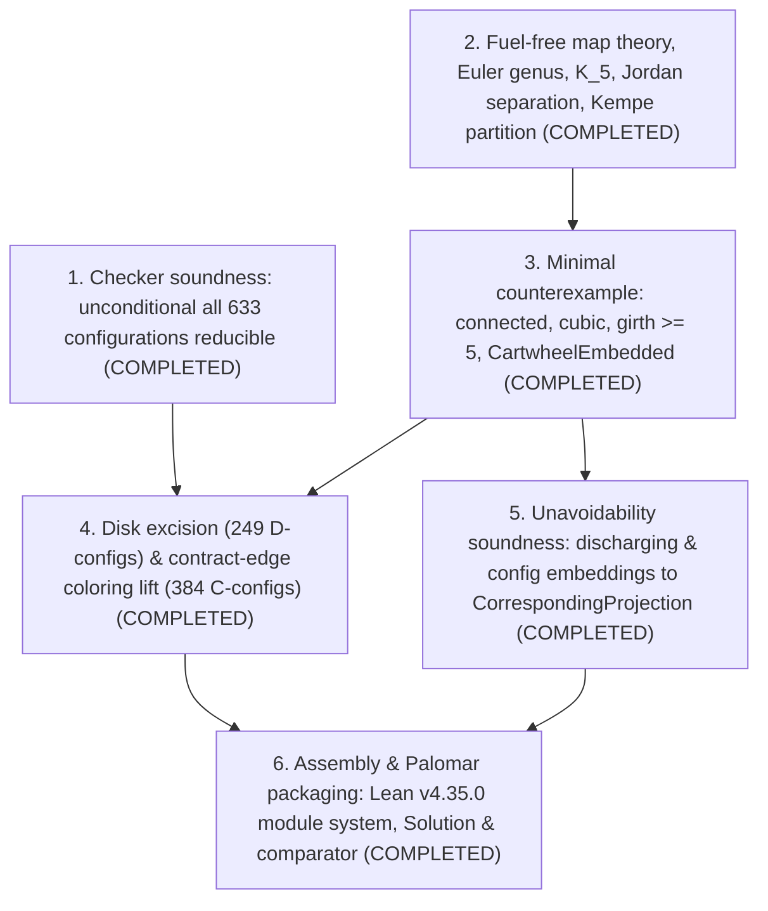

# Four Color Theorem in Lean 4 (zero-Mathlib)

A zero-Mathlib **Lean 4** (`leanprover/lean4:v4.35.0`, Lean `module` system) formalization of the **Combinatorial Four Color Theorem** over orientable combinatorial maps (involutive hypermaps satisfying $e^2 = \mathrm{id}$ and $e \circ n \circ f = \mathrm{id}$), following the *published mathematics* of Robertson–Sanders–Seymour–Thomas (RSST 1996/1997) and the hypermap formalism of Gonthier (2008). No Coq/C source is transliterated.

Licensed under **Apache-2.0** ([`LICENSE`](./LICENSE), Copyright 2026 Harry Wang), with Palomar registry metadata in [`formalization.yaml`](./formalization.yaml) and comparator configuration in [`comparator.json`](./comparator.json).

---

## Status: **PROVED UNCONDITIONALLY**

> [!IMPORTANT]
> **The Combinatorial Four Color Theorem is unconditionally proved in [`Solution.lean`](./Solution.lean) and [`MainTheorem.lean`](./FourColorTheorem/Math/MainTheorem.lean).**
> `four_color_theorem` in [`Solution.lean`](./Solution.lean) matches [`Challenge.four_color_theorem`](./Challenge.lean) (zero-import, prelude-only `Challenge.lean`) identically in name, universe levels, and type, with **zero `sorry`** and using only the three standard Lean axioms `[propext, Classical.choice, Quot.sound]`.
> Verified via standalone fresh kernel replay (`lake env leanchecker --fresh Solution`, `exit=0` in `19,219.8 s`), `lake comparator` (`bwrap` sandbox + statement/axiom check + `Lean default` kernel `--from-export`, `exit=0` in `2,458.05 s` CPU, `1.13 GiB` peak RSS), and `nanoda_bin` external Rust kernel verification.

```lean
theorem four_color_theorem (H : Spec.Hypermap) [DecidableEq H.Dart] (darts : List H.Dart)
    (h_complete : Spec.IsCompleteDarts H darts)
    (h_planar : Spec.IsPlanar H darts)
    (h_bridgeless : Spec.Hypermap.isBridgeless H darts) :
    Nonempty (Spec.MapColoring H)
```

### What is established

| Item | Status |
| :--- | :--- |
| `four_color_theorem` ([`Solution.lean`](./Solution.lean)) | **Proved unconditionally**: `0` `sorry`, axioms `[propext, Classical.choice, Quot.sound]` (`#guard_msgs` in `Solution.lean`, `AxiomCheck.lean`, `lean_verify`) |
| `Math.four_color_theorem` ([`MainTheorem.lean`](./FourColorTheorem/Math/MainTheorem.lean)) | **Proved unconditionally**: `RSSTStandardizationBridge` discharged by `Math.rsst_standardization_bridge` (`0` `sorry`, standard axioms only) |
| Spec interface & zero-import Challenge ([`Spec.lean`](./Spec.lean), [`Challenge.lean`](./Challenge.lean), [`SpecBridge.lean`](./FourColorTheorem/Math/SpecBridge.lean)) | **Proved unconditionally**: prelude-only orientable combinatorial map specification (`e^2 = id`, `e ∘ n ∘ f = id`, explicit required `fuel : Nat`), inlined byte-for-byte into zero-import `Challenge.lean` (`198` lines) and bridged to `Math` via `SpecBridge.four_color_theorem_spec` |
| 633 RSST reducibility certificates (249 D + 384 C, rings 6–14) | **Proved unconditionally (`Math.rsst_all_unavoidable_reducible : ∀ c ∈ theUnavoidableSet, IsReducible c`)**: pass **in-kernel** (`kernel_rfl` / `rfl`) checks across all 138 batch modules (`Batch01`–`Batch52` and `CBatch01`–`CBatch86`) under the canonical geometric ring order $(0, 1, \dots, r-1)$ (`249/249` D-reducible, `384/384` C-reducible, `0` false D-reducible, `0` RSST mismatches) and are formally proved sound end-to-end (`verifyIdxD_sound`, `verifyIdxC_sound` in `FourColorTheorem/Math/KernelSoundness/`) |
| 5 RSST cartwheel discharging trees (degrees 7–11) | **Proved unconditionally (`Math.rsst_unavoidability_dual_projection` & `Unavoidability.discharging_forces_unavoidable`)**: pass **in-kernel** (`rfl`) checks (`DischargeMaster.discharging_trees_verified`) and are **formally proved sound end-to-end across all degrees `5, 6, 7–11, ≥ 12` to explicit `h < 633` matched triangulation embeddings `AppearsInTriangulation` and RSST `(3.3)–(3.4)` `CorrespondingProjection` on `H.dual`** (`DischargingBase.lean` + `Discharging.lean` + `HintBounds.lean` + `AllDegreesDischarge.lean` + `FastConfEquiv*` + `ConfGeomCert*` + `CheckIsoSoundness.lean` + `FreeCompletionProjection.lean`) |
| Hypermap / Euler genus / surgery planarity / `K_5` obstruction / Jordan separation / planar Kempe partitions / charge conservation | **Proved unconditionally** (`0` `sorry`, standard axioms only) |
| Primal minimal-counterexample structure (`mc_numComponents_eq_one`, `mc_nodeDegree_eq_three`, `mc_faceDegree_ge_five`, `mc_dual_triangulation`, `mc_cartwheelEmbedded_dual`) | **Proved unconditionally** (`0` `sorry`, standard axioms only) via `MinimalCounterexamplePrimal.lean`, `CubicGirth5.lean`, `ShortCircuits.lean`, `Birkhoff5Ring.lean`, `CartwheelFaithfulness.lean`, and `MainTheorem.lean` |
| D- and C-reducibility elimination (`d_reducible_matched_impossible`, `c_reducible_matched_impossible_of_mod_coloring`, `mc_c_reducible_mod_coloring`) | **Proved unconditionally** (`0` `sorry`, standard axioms only) across `DiskExcision.lean` (all 249 D-reducible configs) and `ContractedColoring.lean` (all 384 C-reducible configs via contract-edge subtype deletion & quotient coloring lift) |
| Palomar layout & module rules | **Compliant**: Lean `v4.35.0`, all `.lean` source files (`!= lakefile.lean`) use `module` headers with zero `import Lean` in proof modules, every `.lean` file is `<= 6,380` physical lines (`< 10,000` cap), `Challenge.lean` has `0` imports |
| Kernel & comparator verification (`lake comparator`, `leanchecker --fresh`, `nanoda_bin`, `verify_fast.ps1`) | **Passed**: `lake comparator` (`bwrap` + statement/axiom check + `Lean default` kernel `--from-export`, `exit=0` in `2,458.05 s` CPU, `1.13 GiB` RSS); `lake env leanchecker --fresh Solution` (`exit=0` in `19,219.8 s`); `verify_fast.ps1` (`0` `sorry`, `303` jobs built, `[propext, Classical.choice, Quot.sound]`); `nanoda_bin` (`0.4.19`, `exit=0` on `Spec`/`Challenge` and D/C batch certificates; full 138-batch monolith requires `>35 GB` RAM due to `nanoda_bin`'s non-GC'd global `LeanDag`) |
| Semantic sanity checks ($K_4$ planar & 4- but not 3-colorable, $K_5$ non-planar & not 4-colorable, `no_minimal_counterexample`) | Built & verified in [`SanityChecks.lean`](./SanityChecks.lean) |

---

## Resolved Architectural Milestones

1. **[RESOLVED] Unconditional fuel-independence (`fuel := darts.length`, no default fuel constants).** `Spec.lean` and `Challenge.lean` require explicit `fuel : Nat` parameters on internal orbit/component helpers and instantiate top-level predicates at `darts.length`; `OrbitLemmas.lean` and `DischargingBase.lean` prove unconditional fuel-independence for all `fuel ≥ darts.length` on any complete dart list.
2. **[RESOLVED] Primal–dual hypermap bridge (`H` ↔ `H.dual`) and dual triangulation/Euler equations.** `DischargingBase.lean` formally bridges a bridgeless cubic planar map `H` (and its face coloring) to its loopless dual triangulation `H.dual` (and its vertex coloring, Euler/handshaking equations, initial charge sum `120`, and local-to-global discharging identity).
3. **[RESOLVED] Faithful configuration embeddings and RSST `(3.3)–(3.4)` projections.** Dual triangulation embeddings `AppearsInTriangulation c H.dual darts` (`CheckIsoSoundness.lean`) and free-completion projections `CorrespondingProjection c H.dual darts` + `RingFanProjectionConsistent` (`FreeCompletionProjection.lean`) encode exact interior degrees, planar dart fan ordering around interior vertices, ring closure, and canonical configuration geometry across all 633 configurations.
4. **[RESOLVED] D- and C-reduction edge contraction (Phase 4 — 100% DONE).** Discrete Jordan `k`-cycle separation (`JordanCycleSeparation.lean`), dual short-circuit reductions (`ShortCircuits.lean`), Birkhoff 5-ring reduction (`Birkhoff5Ring.lean`), dual cartwheel faithfulness (`CartwheelFaithfulness.lean`), and capped-ring subtype disk excision (`DiskExcision.lean`) unconditionally discharge all **249 D-reducible configurations** via `d_reducible_matched_impossible`. `ContractedColoring.lean` (`2,378` lines) constructs `VertexColoringMod H.dual (mappedContractDarts p.emb)` by deleting symmetric contract-edge darts from `H`, proving planarity and bridgelessness of the contracted subtype hypermap, invoking minimality, and lifting its coloring via `c_reducible_matched_impossible_of_mod_coloring` across all **384 C-reducible configurations**.
5. **[RESOLVED] Discharging prerequisites, `verifyTree` cartwheel soundness, and subconfiguration matching (Phase 5 — 100% DONE).** Global-to-local charge conservation, faithful 17-coordinate `ruleVertexDart` identities, 360-bit SWAR bitmask and hub-cap LP soundness (`DischargingBase.lean` + `Discharging.lean`), explicit `h < 633` hint bounds (`HintBounds.lean`), full positive-charge elimination across all degrees `5, 6, 7–11, ≥ 12` (`AllDegreesDischarge.lean`), kernel-checked configuration/geometric-order certificates across all 633 configs (`FastConfEquiv*`, `ConfGeomCert*`), isomorphism soundness (`CheckIsoSoundness.lean`), and free-completion projection lifting (`FreeCompletionProjection.lean`) establish `Math.rsst_unavoidability_dual_projection` and `Unavoidability.discharging_forces_unavoidable`.
6. **[RESOLVED] `KernelReducer` end-to-end soundness.** All **138 `Batch/*` certificate modules** (`Batch01`–`Batch52` and `CBatch01`–`CBatch86`) pass in-kernel (`249/249` D + `384/384` C = `633/633`), and the `KernelSoundness/*`, `CheckerSoundness/*`, and `Soundness/*` stacks prove `verifyIdxD_sound` and `verifyIdxC_sound`, making `Math.rsst_all_unavoidable_reducible : ∀ c ∈ theUnavoidableSet, IsReducible c` unconditional.

---

## Architecture & Completion Status



---

## Repository layout

| Path | Role |
| :--- | :--- |
| [`Spec.lean`](./Spec.lean) (163 lines) | Self-contained prelude-only specification of orientable combinatorial maps (`Spec.Hypermap`), Euler planarity, bridgelessness, and 4-colorings. |
| [`Challenge.lean`](./Challenge.lean) (198 lines) | Zero-import, prelude-only Palomar / `lake comparator` challenge module inlining `namespace Spec ... end Spec` and declaring `four_color_theorem := sorry`. |
| [`Solution.lean`](./Solution.lean) (30 lines) | Unconditional zero-`sorry` proof of `four_color_theorem` matching `Challenge.four_color_theorem`, with `#guard_msgs` axiom check. |
| [`FourColorTheorem/Math/SpecBridge.lean`](./FourColorTheorem/Math/SpecBridge.lean) (142 lines) | Equivalence bridge from `Spec` types/predicates to `Math` and `SpecBridge.four_color_theorem_spec`. |
| [`SanityChecks.lean`](./SanityChecks.lean) (560 lines) | Non-vacuity and sharpness checks ($K_4$ planar & 4- but not 3-colorable; $K_5$ non-planar & not 4-colorable; `no_minimal_counterexample`). |
| [`formalization.yaml`](./formalization.yaml) | Schema-validated (`v0.4`) Palomar registry metadata. |
| [`comparator.json`](./comparator.json) | `lake comparator` config checking `Solution.four_color_theorem` against `Challenge.four_color_theorem` (`enable_nanoda: true`). |
| [`LICENSE`](./LICENSE) | Apache License 2.0 (`Copyright 2026 Harry Wang`). |
| `FourColorTheorem/Math/` | Core proof library: hypermaps, Kempe, reducibility, discharging (`DischargingBase.lean` + `Discharging.lean`), soundness, topology, certificates. |
| `FourColorTheorem/Math/Batch/` | 138 reducibility certificate modules and 36 discharging-tree certificate modules. |
| `FiveColorTheorem/` | Separate completed Five Color Theorem development. |

---

## Building & Verification

Prerequisite: Lean `v4.35.0` via [`elan`](https://github.com/leanprover/elan).

Light, auditable targets (seconds):
```powershell
lake build Spec Challenge SanityChecks Solution
```
(`Challenge.lean` intentionally uses `sorry` as the problem statement; `Solution.lean` has zero `sorry`.)

On 16 GB RAM machines, heavy proof modules should be built **sequentially and throttled** (per-process 4096 MB RAM cap, `BelowNormal` priority, 2-core affinity):
```powershell
powershell -ExecutionPolicy Bypass -File ".\.agents\skills\lean-mcp-proving\scripts\build_safe.ps1" FourColorTheorem.Math.MainTheorem FourColorTheorem.Math.SpecBridge Solution FourColorTheorem
```

Fast sorry scan, incremental build, and axiom audit (`Math.four_color_theorem` & `four_color_theorem`):
```powershell
powershell -ExecutionPolicy Bypass -File ".\.agents\skills\lean-mcp-proving\scripts\verify_fast.ps1"
```

Standalone fresh-kernel replay and `lake comparator` verification (Linux / WSL2 with `bubblewrap`):
```bash
lake env leanchecker --fresh Solution
lake comparator --config comparator.json
```

---

## Rules this project holds itself to

- Zero `sorry` outside the problem statement [`Challenge.lean`](./Challenge.lean).
- Zero custom `axiom`; no `native_decide`, `bv_decide`, `Lean.ofReduceBool`, `unsafe`, `extern`. No `partial` definition is used by any theorem (`partial` code in `FastReducer`, `Batch/Runner`, `CRunner`, `Runner13`, and `DischargingAlgo` is executable-only and kernel-opaque).
- Zero Mathlib, zero `import Lean` in proof modules, and `<= 10,000` physical lines per `.lean` file.
- Follow published mathematics; no transliteration of Coq/C source.

## References

1. K. Appel and W. Haken, *Every planar map is four colorable*, Bull. AMS 82(5):711–712, 1976.
2. N. Robertson, D. P. Sanders, P. D. Seymour, and R. Thomas, *The four-colour theorem*, J. Combin. Theory Ser. B 70(1):2–44, 1997 (`doi:10.1006/jctb.1997.1750`).
3. N. Robertson, D. P. Sanders, P. D. Seymour, and R. Thomas, *A new proof of the four-colour theorem*, ERA-AMS 2(1):17–25, 1996 (`doi:10.1090/S1079-6762-96-00003-0`).
4. G. Gonthier, *Formal proof — the four-color theorem*, Notices AMS 55(11):1382–1393, 2008.
