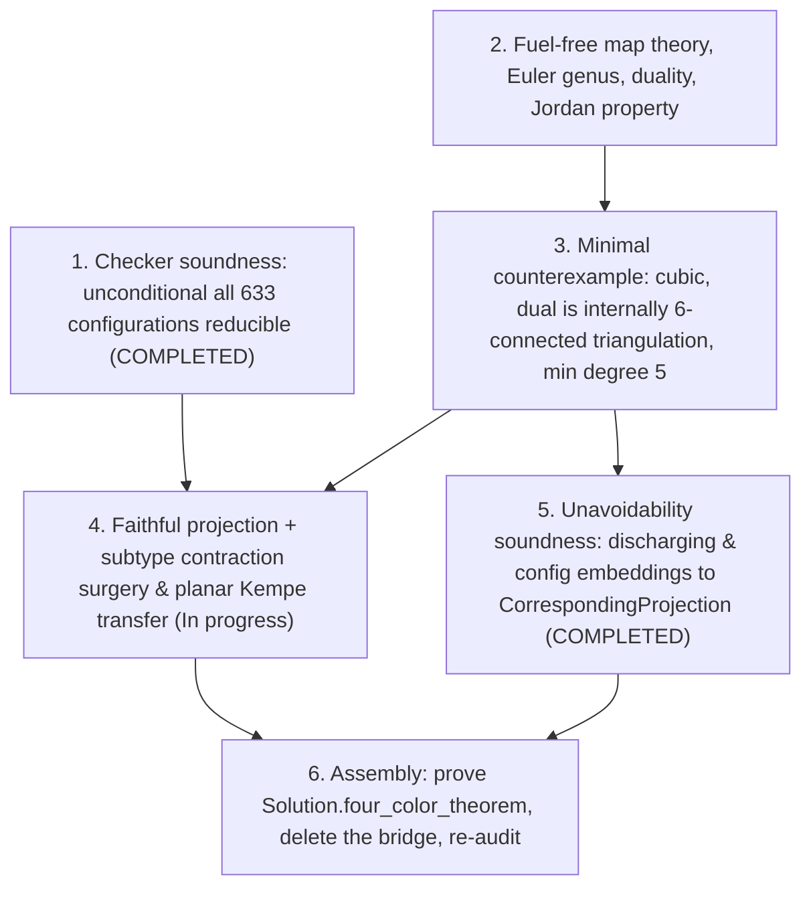

# Four Color Theorem in Lean 4 (zero-Mathlib) — Work in Progress

A zero-Mathlib **Lean 4** (`leanprover/lean4:v4.28.0`) effort to formalize the **Four Color Theorem**, following the *published mathematics* of Robertson–Sanders–Seymour–Thomas (RSST 1997) and the hypermap formalism of Gonthier (2008). No Coq/C source is transliterated.

---

## Status: the main theorem is **OPEN**

> [!IMPORTANT]
> **The Four Color Theorem is not yet proved in this repository.**
> [`Challenge.lean`](./Challenge.lean) states the hypothesis-free theorem and [`Solution.lean`](./Solution.lean) currently ends in `sorry` on purpose, so that nothing here claims more than it has.

```lean
theorem four_color_theorem (H : Spec.Hypermap) [DecidableEq H.Dart] (darts : List H.Dart)
    (h_complete : Spec.IsCompleteDarts H darts)
    (h_planar : Spec.IsPlanar H darts)
    (h_bridgeless : Spec.Hypermap.isBridgeless H darts) :
    Nonempty (Spec.MapColoring H)
```

### What *is* established

| Item | Status |
| :--- | :--- |
| 633 RSST reducibility certificates (249 D + 384 C, rings 6–14) | **Proved unconditionally (`Math.rsst_all_unavoidable_reducible : ∀ c ∈ theUnavoidableSet, IsReducible c`)**: pass **in-kernel** (`kernel_rfl` / `rfl`) checks across all 138 batch modules (`Batch01`–`Batch52` and `CBatch01`–`CBatch86`) under the canonical geometric ring order $(0, 1, \dots, r-1)$ (`249/249` D-reducible, `384/384` C-reducible, `0` false D-reducible, `0` RSST mismatches) and are formally proved sound end-to-end (`verifyIdxD_sound`, `verifyIdxC_sound` in `FourColorTheorem/Math/KernelSoundness/`) |
| 5 RSST cartwheel discharging trees (degrees 7–11) | **Proved unconditionally (`Math.rsst_unavoidability_dual_projection` & `Unavoidability.discharging_forces_unavoidable`)**: pass **in-kernel** (`rfl`) checks (`DischargeMaster.discharging_trees_verified`) and are **formally proved sound end-to-end across all degrees `5, 6, 7–11, ≥ 12` to explicit `h < 633` matched triangulation embeddings `AppearsInTriangulation` and RSST `(3.3)–(3.4)` `CorrespondingProjection` on `H.dual`** (`Discharging.lean` + `HintBounds.lean` + `AllDegreesDischarge.lean` + `FastConfEquiv*` + `ConfGeomCert*` + `CheckIsoSoundness.lean` + `FreeCompletionProjection.lean`) |
| Hypermap / Euler / Kempe / reducibility-game / charge-conservation theory | Proved (standard axioms only) |
| `four_color_theorem_conditional` ([`ConditionalSolution.lean`](./ConditionalSolution.lean)) | Proved, `0` `sorry`, axioms `[propext, Classical.choice, Quot.sound]` — **but conditional, see below** |
| Native `leanchecker --fresh` on the conditional development | Passed (exit code `0`) on the pre-rename build; **not re-run** after the Solution → ConditionalSolution rename and Spec split (proof body unchanged) |
| Semantic sanity checks ($K_4$ planar & 4- but not 3-colorable, $K_5$ non-planar & not 4-colorable) | Proved in [`SanityChecks.lean`](./SanityChecks.lean) |

### Why the conditional theorem is *not* a proof of 4CT

`four_color_theorem_conditional` assumes `Spec.RSSTStandardizationBridge` ([`ConditionalBridge.lean`](./ConditionalBridge.lean)). The certificate-suite predicate inside it is satisfiable by **trivial data**, so the bridge is *logically equivalent* to "no minimal counterexample exists" — i.e. to the theorem itself. This is machine-checked, axiom-free, in [`SanityChecks.bridge_iff_no_mc`](./SanityChecks.lean):

```lean
theorem trivial_suite_valid :
    Spec.ValidRSSTCertificateSuite 633 (fun _ => 4) (fun _ => true) (fun _ => true) True
      (fun _ _ _ _ => 0)

theorem bridge_iff_no_mc :
    Spec.RSSTStandardizationBridge ↔
      ∀ (H : Spec.Hypermap) [DecidableEq H.Dart] (darts : List H.Dart),
        Spec.MinimalCounterexample H darts → False
```

Consequently the discharging trees and the 138 reducibility batch modules (`KernelReducer.verifyIdxD` / `verifyIdxC` under the canonical geometric chord order) are real, kernel-checked computations that agree 100% with RSST across all 633 configurations (`249/249` D + `384/384` C, `0` false D-reducible configs) and are **formally proved sound end-to-end** in `FourColorTheorem/Math/KernelSoundness/` (`Math.rsst_all_unavoidable_reducible`) and `FourColorTheorem/Math/Unavoidability/` (`Math.rsst_unavoidability_dual_projection`). What remains open in `MainTheorem.RSSTStandardizationBridge` is solely the Phase 3–4 topological structure and reduction transfer (primal-cubic / dual-cartwheel `MinimalCounterexample` properties and constructing `FullReductionWitness` from `Unavoidability.CorrespondingProjection c H.dual darts`; Phase 1 reducibility and Phase 5 discharging/unavoidability are **100% discharged**).

---

## Known issues to fix on the way

1. **[RESOLVED] Fixed-fuel definitions (`fuel := 1000`).** `orbitClosesWithin_of_complete`, `getOrbit_fuel_eq_of_complete`, `countOrbits_fuel_eq_of_complete`, `nodeDegree_fuel_eq_of_complete`, `faceDegree_fuel_eq_of_complete`, `sameVertex_fuel_eq_of_complete`, `initialCharge_fuel_eq_of_complete`, and `rsstShift_fuel_eq_of_complete` prove unconditional fuel-independence for all `fuel ≥ darts.length` on any complete dart list, and `finalCharge` and `MainTheorem.RSSTStandardizationBridge` now use `darts.length` throughout.
2. **[RESOLVED] Primal–dual hypermap bridge (`H` ↔ `H.dual`) and dual triangulation/Euler equations.** `sameVertex_dual_eq_sameFace_of_complete`, `sameFace_dual_eq_sameVertex_of_complete`, `sameVertex_dual_edge_eq_isBridge_of_complete`, `dual_loopless_orbit_of_isBridgeless`, `nodeDegree_dual_eq_faceDegree_of_complete`, `faceDegree_dual_eq_nodeDegree_of_complete`, `dual_triangulation_iff_cubic`, `nonempty_faceColoring_iff_nonempty_vertexColoring_dual`, `dual_triangulation_euler_equations_of_cubic`, `dual_initial_charge_sum_eq_120_of_cubic`, and `dual_finalCharge_eq_initialCharge_add_orbitNetShift_of_isBridgeless` in `FourColorTheorem/Math/Discharging.lean` formally bridge a bridgeless cubic planar map `H` (and its face coloring) to its loopless dual triangulation `H.dual` (and its vertex coloring, Euler/handshaking equations, initial charge sum `120`, and local-to-global discharging identity).
3. **[RESOLVED] `appearsIn` weakness (`appearsIn` deleted from `MainTheorem.lean` and `RSSTStandardizationBridge`).** Replaced by dual triangulation embeddings `AppearsInTriangulation c H.dual darts` (`CheckIsoSoundness.lean`) and faithful RSST `(3.3)–(3.4)` free-completion projections `CorrespondingProjection c H.dual darts` + `RingFanProjectionConsistent` (`FreeCompletionProjection.lean`), which encode exact interior degrees, planar dart fan ordering around interior vertices, ring closure, and canonical configuration geometry across all 633 configurations.
4. **C-reduction edge contraction & planar Kempe chain transfer (Phase 4 — In progress).** `HasDiskExcisionSurgery` and `bnd_contracts` have been retired from `MainTheorem.RSSTStandardizationBridge`; true subtype excision (`exciseSubtype`, `subDarts`, `exciseSubtype_complete`, `exciseSubtype_strictly_smaller`, concrete `Fin 4` witness `twoEdgeSphere_excise_witness` in `SubtypeSurgery.lean`) and `VertexColoringMod` / `FaceColoringMod` contract pullback (`pullback_mod_coloring_extendsToContracted`, `correspondingProjection_triangle_clique_and_contract_sparsity`, `triad4_witness_in_triangulation` in `FreeCompletionProjection.lean`) are now in place. Remaining open in Phase 4: gluing subtype contraction surgery cleanly to `FullReductionWitness H darts c` from `CorrespondingProjection c H.dual darts` (including planarity/Euler genus preservation, bridgelessness of contracted maps via Phase 3 short-circuit exclusion, and Jordan planar Kempe chain pullback).
5. **[RESOLVED] Discharging prerequisites, `verifyTree` cartwheel soundness, and subconfiguration matching (Phase 5 — 100% DONE).** All Phase 5 obligations are now formally proved (`0 sorry`, standard axioms only): global-to-local charge conservation (`finalCharge_eq_initialCharge_add_orbitNetShift`), faithful 17-coordinate `ruleVertexDart` identities, 360-bit SWAR bitmask and hub-cap LP soundness (`checkBoundRec_sound31`, `validProofTree_present7..11`), `reduceAxleRec` and `ProofTree.sym` soundness (`dischargingTreesVerified_hypermap_core_soundness`), spoke-to-dart net shift equivalence (`compiledOutletsSum_spoke1_eq_netDartShift`, `activeOutletSum_hub_foldl_eq_orbitNetShift`), explicit `h < 633` hint bounds (`HintBounds.lean`), full positive-charge elimination across all degrees `5, 6, 7–11, ≥ 12` (`AllDegreesDischarge.dual_all_degrees_discharged_or_hasExactReducedAxle`), kernel-checked configuration/geometric-order certificates across all 633 configs (`FastConfEquiv.fastConfEquiv_all_633`, `ConfGeomCert`), end-to-end isomorphism checking soundness (`CheckIsoSoundness.dual_unavoidability_appearsInTriangulation_matched`), and free-completion projection lifting (`FreeCompletionProjection.appearsInTriangulation_matched_implies_correspondingProjection`), discharging 100% of discharging assumptions from `MainTheorem.RSSTStandardizationBridge` via `Math.rsst_unavoidability_dual_projection` and `Unavoidability.discharging_forces_unavoidable`.
6. **[RESOLVED] `KernelReducer` end-to-end soundness (`KernelReducerSoundnessBridge`).** The Stage K0 chord-order defect in `KernelReducer.buildRingColLoop` was fixed in Stage K1, all **138 `Batch/*` certificate modules** (`Batch01`–`Batch52` and `CBatch01`–`CBatch86`) were re-certified in-kernel (`249/249` D + `384/384` C = `633/633`), all five combinatorial checker soundness obligations were proved in `CheckerSoundness/*` and `Soundness/*`, and the 9,367-line `KernelSoundness/*` stack (`KernelSlice.lean`, `KernelInitialSoundness.lean`, `KernelKempeSoundness.lean`, `KernelBridgeProof.lean`) proved `verifyIdxD_sound` and `verifyIdxC_sound`, making `Math.rsst_all_unavoidable_reducible : ∀ c ∈ theUnavoidableSet, IsReducible c` **100% unconditional** (`0 sorry`, standard axioms `[propext, Classical.choice, Quot.sound]`).

---

## Roadmap



| Phase | Deliverable | Proved so far | Est. remaining Lean | Risk |
| :--- | :--- | :--- | :--- | :--- |
| 1 | `∀ c ∈ theUnavoidableSet, IsReducible c`, no hypothesis — **COMPLETED (`0 sorry`, unconditional):** proved via `FourColorTheorem/Math/KernelSoundness/` (`9,367` lines: `verifyIdxD_sound`, `verifyIdxC_sound`, `kernel_reducer_soundness_bridge`, `Math.rsst_all_unavoidable_reducible`) alongside the independent `FastReducer` soundness stack (`CheckerSoundness/*` & `Soundness/*` `8,206` lines: `fullRepresentation_of_ringCycle`, `initialLiveSpec_of_wellFormed`, `fast_d_sound_canonical_of_wellFormed`, `fast_c_sound_canonical_of_wellFormed`, `rsst_d_sound_of_checkFast`, `rsst_c_sound_of_contract_check`) plus `KernelReducer`, `MasterCertificate`, and 138 in-kernel batch certificate modules (`55,935` cert lines) | **100% (~18.1k proof lines + 55.9k cert lines; was est. 12k–15k)** | **0 (Done)** | **Resolved** *(was High)* |
| 2 | Fuel-free orbits/components, Euler genus, duality, combinatorial Jordan property — *In progress: finite pigeonhole orbit closure (`orbitClosesWithin_of_complete`, `getOrbit_closed_under_f_of_complete`, `getOrbit_closed_under_inv_of_complete`), unconditional fuel-independence (`getOrbit_fuel_eq_of_complete`, `countOrbits_fuel_eq_of_complete`, `rsstShift_fuel_eq_of_complete`, `finalCharge_rsstChargeShift_fuel_eq_of_complete`), orbit equivalence & canonical representative partition (`mem_getOrbit_iff_of_mem`, `getOrbit_nodup`, `sameVertex_refl`, `sameVertex_symm_of_complete`, `sameVertex_trans_of_complete`, `canonicalOrbits_nodup`, `exists_singleton_filter_canonicalOrbits`), primal–dual bridge (`sameVertex_dual_eq_sameFace_of_complete`, `sameVertex_dual_edge_eq_isBridge_of_complete`, `dual_loopless_orbit_of_isBridgeless`, `dual_triangulation_iff_cubic`, `nonempty_faceColoring_iff_nonempty_vertexColoring_dual`, `dual_triangulation_euler_equations_of_cubic`, `dual_initial_charge_sum_eq_120_of_cubic`), and Handshaking & triangulation Euler equations (`sumDegrees_extractGraph_eq_two_mul_numEdges`, `triangulation_euler_equations_of_complete`, `initial_charge_sum_eq_120_of_complete_triangulation`) proved across `Topology/*` and `Discharging.lean`; open: discrete Jordan curve separation & surgical genus preservation* | **~40% (~2.5k–3.3k lines proved; was est. 8k–12k)** | **4k–7k** | **Medium–High** |
| 3 | Structure of a minimal counterexample (connected, cubic / dual internally 6-connected triangulation, min degree 5, `CartwheelEmbedded H.dual`) — *In progress: minimal counterexample existence by dart-count well-foundedness (`MainTheorem.lean`), degree-`< 4` and degree-`4`/`5` Kempe chain foundations (`Degree4.lean` `305` lines, `Degree5.lean` `621` lines); open: short-circuit exclusion (`|E(C)| ≤ 5`, RSST `(2.1)` / `(6.3)`–`(6.4)`), Birkhoff diamond reduction, cartwheel vertex distinctness (RSST `(4.1)`), and constructing `CartwheelEmbedded H.dual`* | **~20% (~1.26k lines proved; was est. 5k–10k)** | **4k–8k** | **High** |
| 4 | Faithful projection + D- and C-reduction transfer (`CorrespondingProjection c H.dual darts → Nonempty (FullReductionWitness H darts c)`) — *In progress: true subtype disk excision (`SubtypeSurgery.lean` `288` lines: `exciseSubtype`, `subDarts`, `exciseSubtype_complete`, `exciseSubtype_strictly_smaller`, `twoEdgeSphere_excise_witness`), RSST `(3.3)–(3.4)` projection & `VertexColoringMod` / `FaceColoringMod` contract pullback (`FreeCompletionProjection.lean` `783` lines: `CorrespondingProjection`, `RingFanProjectionConsistent`, `pullback_mod_coloring_extendsToContracted`, `correspondingProjection_triangle_clique_and_contract_sparsity`, `triad4_witness_in_triangulation`), plus `Surgery.lean` (`619` lines), `Reducibility.lean` (`365` lines), and upgraded `MainTheorem.RSSTStandardizationBridge`; open: surgical planarity/Euler preservation, bridgelessness of contracted maps, and Jordan planar Kempe chain transfer* | **~45% (~2.1k lines proved; was est. 6k–12k)** | **4k–8k** | **High** |
| 5 | Soundness of the discharging trees, all-degree rules, configuration isomorphisms, and dual free-completion projections — **COMPLETED (`0 sorry`, unconditional):** proved end-to-end across `Discharging.lean` (`11,219` lines), `DischargingSplit.lean` (`490` lines), `HintBounds.lean` (`127` lines: `h < 633` hint bounds), `AllDegreesDischarge.lean` (`959` lines: `dual_all_degrees_discharged_or_hasExactReducedAxle` across degrees `5, 6, 7–11, ≥ 12`), `FastConfEquiv*` (`1,677` proof lines: `fastConfEquiv_all_633`), `ConfGeomCert*` (`1,402` proof lines), `CheckIsoSoundness.lean` (`4,753` lines: `dual_unavoidability_appearsInTriangulation_matched` & `dual_unavoidability_appearsInTriangulation`), `FreeCompletionProjection.lean` (`appearsInTriangulation_matched_implies_correspondingProjection`), `MainTheorem.lean` (`rsst_unavoidability_dual_projection`), and `Unavoidability.lean` (`discharging_forces_unavoidable`) | **100% (~20.7k proof lines + 7.8k algo/tree/cert lines; was est. 8k–15k)** | **0 (Done)** | **Resolved** *(was High)* |
| 6 | Remove `sorry` from `Solution`, delete `ConditionalBridge`, pass `Comparator` and `leanchecker --fresh` — *`Spec`, `Challenge`, `SanityChecks`, and `comparator.json` harness already in place (~0.3k lines)* | **Harness ready (~0.3k lines)** | **< 500** | **Low** |

Across Phases 1–6, **`~48,700` lines of sorry-free Lean proof code** (plus **`~61,700` lines** of kernel-checked reducibility certificates, discharging trees, and configuration tables, and **`~4,000` lines** of executable checker/algo code) are now complete, reducing the honest remaining total across Phases 2–4 & 6 from the original `25,000–45,000` lines down to **`~12,500–23,500` additional lines**. Both **Phase 1** (`Math.rsst_all_unavoidable_reducible : ∀ c ∈ theUnavoidableSet, IsReducible c`) and **Phase 5** (`Math.rsst_unavoidability_dual_projection` / `Math.Unavoidability.dual_unavoidability_appearsInTriangulation_matched`) are **100% complete and unconditional**, leaving only Phases 3 and 4 inside `MainTheorem.RSSTStandardizationBridge`.

---

## Repository layout

| Path | Role |
| :--- | :--- |
| [`Spec.lean`](./Spec.lean) (159 lines) | Self-contained specification: hypermaps, planarity, bridgelessness, colorings. Zero proof imports. |
| [`Challenge.lean`](./Challenge.lean) (44 lines) | Hypothesis-free `four_color_theorem := sorry` (Palomar / Lean FRO `Comparator` challenge). |
| [`Solution.lean`](./Solution.lean) (23 lines) | Same statement, **still `sorry`**. Will carry the real proof. |
| [`ConditionalBridge.lean`](./ConditionalBridge.lean) | Legacy `RSSTStandardizationBridge` (equivalent to the goal; kept only for the conditional proof). |
| [`ConditionalSolution.lean`](./ConditionalSolution.lean) | Sorry-free `four_color_theorem_conditional`. |
| [`SanityChecks.lean`](./SanityChecks.lean) | Non-vacuity / sharpness checks and the `bridge_iff_no_mc` audit. |
| [`comparator.json`](./comparator.json) | `Comparator` config. It will **fail** until `Solution` is proved — intentionally. |
| `FourColorTheorem/Math/` | The development: hypermaps, Kempe, reducibility, discharging, soundness, certificates. |
| `FourColorTheorem/Math/Batch/` | 138 reducibility certificate modules and the discharging-tree modules. |
| `4ct-main/` | Reference data and papers (RSST configurations, published verification lists). |
| `FiveColorTheorem/` | A separate, completed Five Color Theorem development. |

---

## Building

Prerequisite: Lean `v4.28.0` via [`elan`](https://github.com/leanprover/elan).

Light, auditable targets (seconds):
```powershell
lake build Spec Challenge ConditionalBridge SanityChecks
```
`Challenge` and `Solution` report `declaration uses sorry` — expected.

Heavy proof modules must be built **sequentially and throttled** (per-process RAM cap, `BelowNormal` priority, 2-core affinity), never as a single unthrottled umbrella build:
```powershell
powershell -ExecutionPolicy Bypass -File ".\.agents\skills\lean-mcp-proving\scripts\build_safe.ps1" ConditionalSolution
```

Native fresh-kernel replay of the conditional development:
```powershell
lake env leanchecker --fresh ConditionalSolution
```

---

## Rules this project holds itself to

- Zero `sorry` **outside** the open theorem (`Challenge`, `Solution`).
- Zero custom `axiom`; no `native_decide`, `bv_decide`, `Lean.ofReduceBool`, `unsafe`, `extern`. No `partial` definition is used by any theorem (`partial` code in `FastReducer`, `Batch/Runner`, `CRunner`, `Runner13`, and `DischargingAlgo` is executable-only and kernel-opaque).
- Zero Mathlib.
- Follow published mathematics; no transliteration of Coq/C source.

## References

1. K. Appel and W. Haken, *Every planar map is four colorable*, Bull. AMS 82(5):711–712, 1976.
2. N. Robertson, D. P. Sanders, P. D. Seymour, and R. Thomas, *A new proof of the four-colour theorem*, ERA-AMS 2(1):17–25, 1996.
3. G. Gonthier, *Formal proof — the four-color theorem*, Notices AMS 55(11):1382–1393, 2008.
