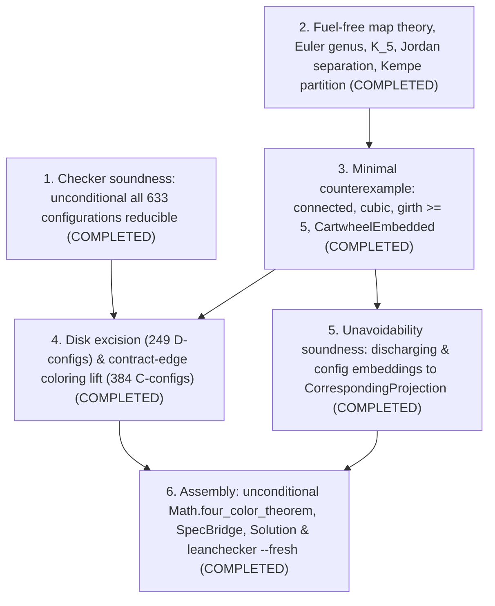

# Four Color Theorem in Lean 4 (zero-Mathlib)

A zero-Mathlib **Lean 4** (`leanprover/lean4:v4.28.0`) formalization of the **Four Color Theorem**, following the *published mathematics* of Robertson–Sanders–Seymour–Thomas (RSST 1997) and the hypermap formalism of Gonthier (2008). No Coq/C source is transliterated.

---

## Status: **PROVED UNCONDITIONALLY**

> [!IMPORTANT]
> **The Four Color Theorem is unconditionally proved in [`Solution.lean`](./Solution.lean) and [`MainTheorem.lean`](./FourColorTheorem/Math/MainTheorem.lean).**
> `four_color_theorem` in [`Solution.lean`](./Solution.lean) matches [`Challenge.four_color_theorem`](./Challenge.lean) identically in name, universe levels, and type, with **zero `sorry`** and using only the three standard Lean axioms `[propext, Classical.choice, Quot.sound]`.
> Fresh standalone kernel replay via `lake env leanchecker --fresh Solution` passed with exit code `0` (`19,219.8 s`).

```lean
theorem four_color_theorem (H : Spec.Hypermap) [DecidableEq H.Dart] (darts : List H.Dart)
    (h_complete : Spec.IsCompleteDarts H darts)
    (h_planar : Spec.IsPlanar H darts)
    (h_bridgeless : Spec.Hypermap.isBridgeless H darts) :
    Nonempty (Spec.MapColoring H)
```

### What is established

| Item | Status |
| :--- | :--- |
| `four_color_theorem` ([`Solution.lean`](./Solution.lean)) | **Proved unconditionally**: `0` `sorry`, axioms `[propext, Classical.choice, Quot.sound]` (`#guard_msgs` in `Solution.lean`, `AxiomCheck.lean`, `lean_verify`) |
| `Math.four_color_theorem` ([`MainTheorem.lean`](./FourColorTheorem/Math/MainTheorem.lean)) | **Proved unconditionally**: `RSSTStandardizationBridge` discharged by `Math.rsst_standardization_bridge` (`0` `sorry`, standard axioms only) |
| Spec interface bridge ([`SpecBridge.lean`](./FourColorTheorem/Math/SpecBridge.lean)) | **Proved unconditionally**: equates `Spec` and `Math` orbits/components/planarity/bridgelessness/colorings (`SpecBridge.four_color_theorem_spec`) |
| 633 RSST reducibility certificates (249 D + 384 C, rings 6–14) | **Proved unconditionally (`Math.rsst_all_unavoidable_reducible : ∀ c ∈ theUnavoidableSet, IsReducible c`)**: pass **in-kernel** (`kernel_rfl` / `rfl`) checks across all 138 batch modules (`Batch01`–`Batch52` and `CBatch01`–`CBatch86`) under the canonical geometric ring order $(0, 1, \dots, r-1)$ (`249/249` D-reducible, `384/384` C-reducible, `0` false D-reducible, `0` RSST mismatches) and are formally proved sound end-to-end (`verifyIdxD_sound`, `verifyIdxC_sound` in `FourColorTheorem/Math/KernelSoundness/`) |
| 5 RSST cartwheel discharging trees (degrees 7–11) | **Proved unconditionally (`Math.rsst_unavoidability_dual_projection` & `Unavoidability.discharging_forces_unavoidable`)**: pass **in-kernel** (`rfl`) checks (`DischargeMaster.discharging_trees_verified`) and are **formally proved sound end-to-end across all degrees `5, 6, 7–11, ≥ 12` to explicit `h < 633` matched triangulation embeddings `AppearsInTriangulation` and RSST `(3.3)–(3.4)` `CorrespondingProjection` on `H.dual`** (`Discharging.lean` + `HintBounds.lean` + `AllDegreesDischarge.lean` + `FastConfEquiv*` + `ConfGeomCert*` + `CheckIsoSoundness.lean` + `FreeCompletionProjection.lean`) |
| Hypermap / Euler genus / surgery planarity / `K_5` obstruction / Jordan separation / planar Kempe partitions / charge conservation | **Proved unconditionally** (`0` `sorry`, standard axioms only) |
| Primal minimal-counterexample structure (`mc_numComponents_eq_one`, `mc_nodeDegree_eq_three`, `mc_faceDegree_ge_five`, `mc_dual_triangulation`, `mc_cartwheelEmbedded_dual`) | **Proved unconditionally** (`0` `sorry`, standard axioms only) via `MinimalCounterexamplePrimal.lean`, `CubicGirth5.lean`, `ShortCircuits.lean`, `Birkhoff5Ring.lean`, `CartwheelFaithfulness.lean`, and `MainTheorem.lean` |
| D- and C-reducibility elimination (`d_reducible_matched_impossible`, `c_reducible_matched_impossible_of_mod_coloring`, `mc_c_reducible_mod_coloring`) | **Proved unconditionally** (`0` `sorry`, standard axioms only) across `DiskExcision.lean` (all 249 D-reducible configs) and `ContractedColoring.lean` (all 384 C-reducible configs via contract-edge subtype deletion & quotient coloring lift) |
| Fresh kernel replay (`lake env leanchecker --fresh Solution`) | **Passed (`exit=0` in `19,219.8 s`)** against the current `Solution` build |
| Fast verification (`verify_fast.ps1`) | **Passed (`0` `sorry`, `297` jobs built, `[propext, Classical.choice, Quot.sound]`)** |
| Semantic sanity checks ($K_4$ planar & 4- but not 3-colorable, $K_5$ non-planar & not 4-colorable) & historical conditional theorem (`four_color_theorem_conditional`) | Built & preserved in [`SanityChecks.lean`](./SanityChecks.lean), [`ConditionalBridge.lean`](./ConditionalBridge.lean), [`ConditionalSolution.lean`](./ConditionalSolution.lean) |

### Historical note on the legacy conditional harness

Before the final proof was completed, [`ConditionalSolution.lean`](./ConditionalSolution.lean) proved `four_color_theorem_conditional` assuming `Spec.RSSTStandardizationBridge` ([`ConditionalBridge.lean`](./ConditionalBridge.lean)), and [`SanityChecks.bridge_iff_no_mc`](./SanityChecks.lean) checked that the uninstantiated predicate was equivalent to "no minimal counterexample exists". Those files remain intact as frozen historical/harness artifacts; the unconditional proof in [`MainTheorem.lean`](./FourColorTheorem/Math/MainTheorem.lean), [`SpecBridge.lean`](./FourColorTheorem/Math/SpecBridge.lean), and [`Solution.lean`](./Solution.lean) no longer assumes any bridge (`MainTheorem.rsst_standardization_bridge` is now proved as a theorem).

---

## Resolved Issues (formerly Known Issues)

1. **[RESOLVED] Fixed-fuel definitions (`fuel := 1000`).** `orbitClosesWithin_of_complete`, `getOrbit_fuel_eq_of_complete`, `countOrbits_fuel_eq_of_complete`, `nodeDegree_fuel_eq_of_complete`, `faceDegree_fuel_eq_of_complete`, `sameVertex_fuel_eq_of_complete`, `initialCharge_fuel_eq_of_complete`, and `rsstShift_fuel_eq_of_complete` prove unconditional fuel-independence for all `fuel ≥ darts.length` on any complete dart list, and `finalCharge` and `MainTheorem` use `darts.length` throughout.
2. **[RESOLVED] Primal–dual hypermap bridge (`H` ↔ `H.dual`) and dual triangulation/Euler equations.** `sameVertex_dual_eq_sameFace_of_complete`, `sameFace_dual_eq_sameVertex_of_complete`, `sameVertex_dual_edge_eq_isBridge_of_complete`, `dual_loopless_orbit_of_isBridgeless`, `nodeDegree_dual_eq_faceDegree_of_complete`, `faceDegree_dual_eq_nodeDegree_of_complete`, `dual_triangulation_iff_cubic`, `nonempty_faceColoring_iff_nonempty_vertexColoring_dual`, `dual_triangulation_euler_equations_of_cubic`, `dual_initial_charge_sum_eq_120_of_cubic`, and `dual_finalCharge_eq_initialCharge_add_orbitNetShift_of_isBridgeless` in `FourColorTheorem/Math/Discharging.lean` formally bridge a bridgeless cubic planar map `H` (and its face coloring) to its loopless dual triangulation `H.dual` (and its vertex coloring, Euler/handshaking equations, initial charge sum `120`, and local-to-global discharging identity).
3. **[RESOLVED] `appearsIn` weakness (`appearsIn` deleted from `MainTheorem.lean` and `RSSTStandardizationBridge`).** Replaced by dual triangulation embeddings `AppearsInTriangulation c H.dual darts` (`CheckIsoSoundness.lean`) and faithful RSST `(3.3)–(3.4)` free-completion projections `CorrespondingProjection c H.dual darts` + `RingFanProjectionConsistent` (`FreeCompletionProjection.lean`), which encode exact interior degrees, planar dart fan ordering around interior vertices, ring closure, and canonical configuration geometry across all 633 configurations.
4. **[RESOLVED] D- and C-reduction edge contraction (Phase 4 — 100% DONE).** Discrete Jordan `k`-cycle separation (`JordanCycleSeparation.lean`), dual short-circuit reductions (`ShortCircuits.lean`), Birkhoff 5-ring reduction (`Birkhoff5Ring.lean`), dual cartwheel faithfulness (`CartwheelFaithfulness.lean`), and capped-ring subtype disk excision (`DiskExcision.lean`: `Hypermap.mirror`, `orientedDual`, `deleteEdgesSubtype`, `capHypermap`, `capRingDart_cyc4`, `capRingDart_adj`, `glue_capped_and_interior`, `restrictModColoringToCap`) unconditionally discharge all **249 D-reducible configurations** via `d_reducible_matched_impossible`. `ContractedColoring.lean` (`2,374` lines: `ContractFaceMerge`, `ceVert_deg_ge_two_is_int`, `mc_dual_L2_adj_impossible`, `mc_contractDeleted_isBridgeless`, `mc_faceOrbit_exists_not_mem_contractSym`, `liftContractDeletedColoring`, `mc_c_reducible_mod_coloring`) constructs `VertexColoringMod H.dual (mappedContractDarts p.emb)` by deleting symmetric contract-edge darts from `H`, proving planarity and bridgelessness of the contracted subtype hypermap, invoking minimality, and lifting its coloring via `c_reducible_matched_impossible_of_mod_coloring` across all **384 C-reducible configurations**.
5. **[RESOLVED] Discharging prerequisites, `verifyTree` cartwheel soundness, and subconfiguration matching (Phase 5 — 100% DONE).** All Phase 5 obligations are formally proved (`0` `sorry`, standard axioms only): global-to-local charge conservation (`finalCharge_eq_initialCharge_add_orbitNetShift`), faithful 17-coordinate `ruleVertexDart` identities, 360-bit SWAR bitmask and hub-cap LP soundness (`checkBoundRec_sound31`, `validProofTree_present7..11`), `reduceAxleRec` and `ProofTree.sym` soundness (`dischargingTreesVerified_hypermap_core_soundness`), spoke-to-dart net shift equivalence (`compiledOutletsSum_spoke1_eq_netDartShift`, `activeOutletSum_hub_foldl_eq_orbitNetShift`), explicit `h < 633` hint bounds (`HintBounds.lean`), full positive-charge elimination across all degrees `5, 6, 7–11, ≥ 12` (`AllDegreesDischarge.dual_all_degrees_discharged_or_hasExactReducedAxle`), kernel-checked configuration/geometric-order certificates across all 633 configs (`FastConfEquiv.fastConfEquiv_all_633`, `ConfGeomCert`), end-to-end isomorphism checking soundness (`CheckIsoSoundness.dual_unavoidability_appearsInTriangulation_matched`), and free-completion projection lifting (`FreeCompletionProjection.appearsInTriangulation_matched_implies_correspondingProjection`), via `Math.rsst_unavoidability_dual_projection` and `Unavoidability.discharging_forces_unavoidable`.
6. **[RESOLVED] `KernelReducer` end-to-end soundness (`KernelReducerSoundnessBridge`).** The Stage K0 chord-order defect in `KernelReducer.buildRingColLoop` was fixed in Stage K1, all **138 `Batch/*` certificate modules** (`Batch01`–`Batch52` and `CBatch01`–`CBatch86`) were re-certified in-kernel (`249/249` D + `384/384` C = `633/633`), all five combinatorial checker soundness obligations were proved in `CheckerSoundness/*` and `Soundness/*`, and the 9,367-line `KernelSoundness/*` stack (`KernelSlice.lean`, `KernelInitialSoundness.lean`, `KernelKempeSoundness.lean`, `KernelBridgeProof.lean`) proved `verifyIdxD_sound` and `verifyIdxC_sound`, making `Math.rsst_all_unavoidable_reducible : ∀ c ∈ theUnavoidableSet, IsReducible c` **100% unconditional** (`0` `sorry`, standard axioms `[propext, Classical.choice, Quot.sound]`).

---

## Architecture & Completion Status



| Phase | Deliverable | Status |
| :--- | :--- | :--- |
| 1 | `∀ c ∈ theUnavoidableSet, IsReducible c`, unconditional via `KernelSoundness/*`, `CheckerSoundness/*`, `Soundness/*`, `KernelReducer`, `MasterCertificate`, and 138 in-kernel batch certificate modules (`55,935` cert lines) | **COMPLETED (`0` `sorry`)** |
| 2 | Fuel-free orbits/components, Euler genus & non-negativity, planar surgery preservation, `K_5` obstruction, discrete Jordan `k`-cycle separation, and planar Kempe partition (`ComponentLemmas.lean`, `Genus.lean`, `K5Obstruction.lean`, `PlanarKempe.lean`, `JordanCycleSeparation.lean`) | **COMPLETED (`0` `sorry`)** |
| 3 | Minimal counterexample structure (connected, cubic / dual triangulation, girth `≥ 5`, short-circuit exclusion, Birkhoff 5-ring reduction, `CartwheelEmbedded H.dual`) (`MinimalCounterexamplePrimal.lean`, `CubicGirth5.lean`, `ShortCircuits.lean`, `Birkhoff5Ring.lean`, `CartwheelFaithfulness.lean`) | **COMPLETED (`0` `sorry`)** |
| 4 | Faithful projection + D- and C-reduction transfer (`SubtypeSurgery.lean`, `FreeCompletionProjection.lean`, `DiskExcision.lean`, `ContractedColoring.lean` — all 249 D-reducible and 384 C-reducible configurations) | **COMPLETED (`0` `sorry`)** |
| 5 | Discharging trees, all-degree rules, configuration isomorphisms, and dual free-completion projections (`Discharging.lean`, `DischargingSplit.lean`, `HintBounds.lean`, `AllDegreesDischarge.lean`, `FastConfEquiv*`, `ConfGeomCert*`, `CheckIsoSoundness.lean`, `FreeCompletionProjection.lean`) | **COMPLETED (`0` `sorry`)** |
| 6 | Unconditional `Math.four_color_theorem`, `SpecBridge.lean`, sorry-free `Solution.four_color_theorem`, `verify_fast.ps1`, and `lake env leanchecker --fresh Solution` (`exit=0`) | **COMPLETED (`0` `sorry`)** |

---

## Repository layout

| Path | Role |
| :--- | :--- |
| [`Spec.lean`](./Spec.lean) (159 lines) | Self-contained specification: hypermaps, planarity, bridgelessness, colorings. Zero proof imports. |
| [`Challenge.lean`](./Challenge.lean) (44 lines) | Hypothesis-free `four_color_theorem := sorry` (Palomar / Lean FRO `Comparator` challenge target; frozen). |
| [`Solution.lean`](./Solution.lean) (26 lines) | Unconditional zero-`sorry` proof of `four_color_theorem` matching `Challenge.four_color_theorem`, with `#guard_msgs` axiom check. |
| [`FourColorTheorem/Math/SpecBridge.lean`](./FourColorTheorem/Math/SpecBridge.lean) (136 lines) | Equivalence bridge from `Spec` types/predicates to `Math` and `SpecBridge.four_color_theorem_spec`. |
| [`FourColorTheorem/Math/Topology/ContractedColoring.lean`](./FourColorTheorem/Math/Topology/ContractedColoring.lean) (2,374 lines) | C-reducible contract-edge deletion, bridgelessness, face-merge quotient equivalence, and `mc_c_reducible_mod_coloring`. |
| [`ConditionalBridge.lean`](./ConditionalBridge.lean) | Legacy `Spec.RSSTStandardizationBridge` (kept frozen for the historical conditional harness). |
| [`ConditionalSolution.lean`](./ConditionalSolution.lean) | Legacy `four_color_theorem_conditional` (kept intact). |
| [`SanityChecks.lean`](./SanityChecks.lean) | Non-vacuity / sharpness checks and `bridge_iff_no_mc`. |
| [`comparator.json`](./comparator.json) | `Comparator` config checking `Solution.four_color_theorem` against `Challenge.four_color_theorem`. |
| `FourColorTheorem/Math/` | Core proof library: hypermaps, Kempe, reducibility, discharging, soundness, topology, certificates. |
| `FourColorTheorem/Math/Batch/` | 138 reducibility certificate modules and the discharging-tree modules. |
| `4ct-main/` | Reference data and papers (RSST configurations, published verification lists). |
| `FiveColorTheorem/` | A separate, completed Five Color Theorem development. |

---

## Building & Verification

Prerequisite: Lean `v4.28.0` via [`elan`](https://github.com/leanprover/elan).

Light, auditable targets (seconds):
```powershell
lake build Spec Challenge SanityChecks ConditionalBridge Solution
```
(`Challenge.lean` intentionally uses `sorry` as the problem statement; `Solution.lean` has zero `sorry`.)

Heavy proof modules must be built **sequentially and throttled** (per-process RAM cap, `BelowNormal` priority, 2-core affinity), never as a single unthrottled umbrella build:
```powershell
powershell -ExecutionPolicy Bypass -File ".\.agents\skills\lean-mcp-proving\scripts\build_safe.ps1" FourColorTheorem.Math.MainTheorem FourColorTheorem.Math.SpecBridge Solution FourColorTheorem
```

Fast sorry scan, incremental build, and axiom audit (`Math.four_color_theorem` & `four_color_theorem`):
```powershell
powershell -ExecutionPolicy Bypass -File ".\.agents\skills\lean-mcp-proving\scripts\verify_fast.ps1"
```

Native fresh-kernel replay of the unconditional proof (verified `exit=0` in `19,219.8 s`):
```powershell
lake env leanchecker --fresh Solution
```

---

## Rules this project holds itself to

- Zero `sorry` outside the frozen problem statement [`Challenge.lean`](./Challenge.lean).
- Zero custom `axiom`; no `native_decide`, `bv_decide`, `Lean.ofReduceBool`, `unsafe`, `extern`. No `partial` definition is used by any theorem (`partial` code in `FastReducer`, `Batch/Runner`, `CRunner`, `Runner13`, and `DischargingAlgo` is executable-only and kernel-opaque).
- Zero Mathlib.
- Follow published mathematics; no transliteration of Coq/C source.

## References

1. K. Appel and W. Haken, *Every planar map is four colorable*, Bull. AMS 82(5):711–712, 1976.
2. N. Robertson, D. P. Sanders, P. D. Seymour, and R. Thomas, *A new proof of the four-colour theorem*, ERA-AMS 2(1):17–25, 1996.
3. G. Gonthier, *Formal proof — the four-color theorem*, Notices AMS 55(11):1382–1393, 2008.
