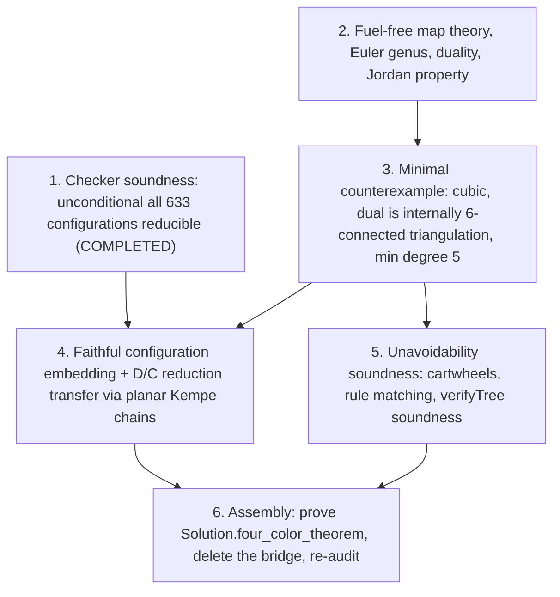

# Four Color Theorem in Lean 4 (zero-Mathlib) — Work in Progress

A zero-Mathlib **Lean 4** (`leanprover/lean4:v4.28.0`) effort to formalize the **Four Color Theorem**, following the *published mathematics* of Robertson–Sanders–Seymour–Thomas (RSST 1997) and the hypermap formalism of Gonthier (2008). No Coq/C source is transliterated.

---

## Status: the main theorem is **OPEN**

> [!IMPORTANT]
> **The Four Color Theorem is not yet proved in this repository.**
> [`Challenge.lean`](./Challenge.lean) states the hypothesis-free theorem and [`Solution.lean`](./Solution.lean) currently ends in `sorry` on purpose, so that nothing here claims more than it has.

```lean
theorem four_color_theorem (H : Spec.Hypermap) [DecidableEq H.Dart] (darts : List H.Dart)
    (h_complete : Spec.IsCompleteDarts H darts)
    (h_planar : Spec.IsPlanar H darts)
    (h_bridgeless : Spec.Hypermap.isBridgeless H darts) :
    Nonempty (Spec.MapColoring H)
```

### What *is* established

| Item | Status |
| :--- | :--- |
| 633 RSST reducibility certificates (249 D + 384 C, rings 6–14) | **Proved unconditionally (`Math.rsst_all_unavoidable_reducible : ∀ c ∈ theUnavoidableSet, IsReducible c`)**: pass **in-kernel** (`kernel_rfl` / `rfl`) checks across all 138 batch modules (`Batch01`–`Batch52` and `CBatch01`–`CBatch86`) under the canonical geometric ring order $(0, 1, \dots, r-1)$ (`249/249` D-reducible, `384/384` C-reducible, `0` false D-reducible, `0` RSST mismatches) and are formally proved sound end-to-end (`verifyIdxD_sound`, `verifyIdxC_sound` in `FourColorTheorem/Math/KernelSoundness/`) |
| 5 RSST cartwheel discharging trees (degrees 7–11) | Pass **in-kernel** (`rfl`) checks |
| Hypermap / Euler / Kempe / reducibility-game / charge-conservation theory | Proved (standard axioms only) |
| `four_color_theorem_conditional` ([`ConditionalSolution.lean`](./ConditionalSolution.lean)) | Proved, `0` `sorry`, axioms `[propext, Classical.choice, Quot.sound]` — **but conditional, see below** |
| Native `leanchecker --fresh` on the conditional development | Passed (exit code `0`) on the pre-rename build; **not re-run** after the Solution → ConditionalSolution rename and Spec split (proof body unchanged) |
| Semantic sanity checks ($K_4$ planar & 4- but not 3-colorable, $K_5$ non-planar & not 4-colorable) | Proved in [`SanityChecks.lean`](./SanityChecks.lean) |

### Why the conditional theorem is *not* a proof of 4CT

`four_color_theorem_conditional` assumes `Spec.RSSTStandardizationBridge` ([`ConditionalBridge.lean`](./ConditionalBridge.lean)). The certificate-suite predicate inside it is satisfiable by **trivial data**, so the bridge is *logically equivalent* to "no minimal counterexample exists" — i.e. to the theorem itself. This is machine-checked, axiom-free, in [`SanityChecks.bridge_iff_no_mc`](./SanityChecks.lean):

```lean
theorem trivial_suite_valid :
    Spec.ValidRSSTCertificateSuite 633 (fun _ => 4) (fun _ => true) (fun _ => true) True
      (fun _ _ _ _ => 0)

theorem bridge_iff_no_mc :
    Spec.RSSTStandardizationBridge ↔
      ∀ (H : Spec.Hypermap) [DecidableEq H.Dart] (darts : List H.Dart),
        Spec.MinimalCounterexample H darts → False
```

Consequently the discharging trees and the 138 reducibility batch modules (`KernelReducer.verifyIdxD` / `verifyIdxC` under the canonical geometric chord order) are real, kernel-checked computations that agree 100% with RSST across all 633 configurations (`249/249` D + `384/384` C, `0` false D-reducible configs) and are now **formally proved sound end-to-end** in `FourColorTheorem/Math/KernelSoundness/`, yielding the unconditional theorem `Math.rsst_all_unavoidable_reducible : ∀ c ∈ theUnavoidableSet, IsReducible c`. What remains open in `MainTheorem.RSSTStandardizationBridge` are the Phase 2–5 topological and discharging obligations (see issues #1–#5 below).

---

## Known issues to fix on the way

1. **[RESOLVED] Fixed-fuel definitions (`fuel := 1000`).** `orbitClosesWithin_of_complete`, `getOrbit_fuel_eq_of_complete`, `countOrbits_fuel_eq_of_complete`, `nodeDegree_fuel_eq_of_complete`, `faceDegree_fuel_eq_of_complete`, `sameVertex_fuel_eq_of_complete`, `initialCharge_fuel_eq_of_complete`, and `rsstShift_fuel_eq_of_complete` prove unconditional fuel-independence for all `fuel ≥ darts.length` on any complete dart list, and `finalCharge` and `MainTheorem.RSSTStandardizationBridge` now use `darts.length` throughout.
2. **[RESOLVED] Primal–dual hypermap bridge (`H` ↔ `H.dual`) and dual triangulation/Euler equations.** `sameVertex_dual_eq_sameFace_of_complete`, `sameFace_dual_eq_sameVertex_of_complete`, `sameVertex_dual_edge_eq_isBridge_of_complete`, `dual_loopless_orbit_of_isBridgeless`, `nodeDegree_dual_eq_faceDegree_of_complete`, `faceDegree_dual_eq_nodeDegree_of_complete`, `dual_triangulation_iff_cubic`, `nonempty_faceColoring_iff_nonempty_vertexColoring_dual`, `dual_triangulation_euler_equations_of_cubic`, `dual_initial_charge_sum_eq_120_of_cubic`, and `dual_finalCharge_eq_initialCharge_add_orbitNetShift_of_isBridgeless` in `FourColorTheorem/Math/Discharging.lean` formally bridge a bridgeless cubic planar map `H` (and its face coloring) to its loopless dual triangulation `H.dual` (and its vertex coloring, Euler/handshaking equations, initial charge sum `120`, and local-to-global discharging identity).
3. **`appearsIn` is too weak.** It has no interior-closure condition (interior vertices may have outside neighbours) and `Configuration` stores no degrees.
4. **`bnd_contracts` is false for C-reduction.** C-reducibility must *contract* edges in the map, not excise the interior.
5. **Discharging prerequisites (partially proved):** Global-to-local charge decomposition (`vertexRuleOutflow_opp_eq_filter_u`, `rsstShift_eq_filter_netDartShift`, `sumShiftsTo_rsstChargeShift_eq_orbitNetShift`, `finalCharge_eq_initialCharge_add_orbitNetShift`), faithful 17-coordinate `ruleVertexDart` cartwheel neighbor identities (`ruleVertexDart_edge_two`, `ruleVertexDart_edge_three`, `ruleVertexDart_edge_six`, `ruleVertexDart_edge_seven`, `ruleVertexDart_edge_fifteen`, `ruleVertexDart_edge_sixteen`, `ruleVertexDart_four`, `ruleVertexDart_five`, `ruleVertexDart_twelve`, `ruleVertexDart_thirteen`, `ruleVertexDart_fourteen`), universal, mutual-exclusion, and hub-neighbor per-dart outflow bounds across all 35 RSST rules (`dartRuleOutflow_le_9`, `dartRuleOutflow_le_7_of_target_deg_ge_8`, `dartRuleOutflow_le_6_of_deg_ne_7`, `dartRuleOutflow_le_4_of_deg_8`, `dartRuleOutflow_eq_zero_of_deg_ge_6_of_flanking_spokes_ge_7`, `dartRuleOutflow_eq_zero_of_deg_ge_8_of_two_step_spokes_ge_6`, `dartRuleOutflow_le_4_of_mem_getOrbit_of_neighbors_deg_ge_6`, `dartRuleOutflow_le_2_of_mem_getOrbit_of_neighbors_deg_ge_6_of_flanking_spoke_ge_7`, `two_le_orientOutflowDegs_of_deg_5_of_target_deg_ge_7_of_deg3_5`, `orientOutflowDegs_eq_3_of_deg_5_of_target_deg_ge_7_of_deg3_5_of_deg5_5`), degree-6 discharging (`finalCharge_eq_orbitNetShift_of_deg_6`, `finalCharge_le_zero_of_deg_6_of_neighbors_deg_ge_7`), unconditional/neighborhood-driven global `finalCharge` theorems (`finalCharge_eq_initialCharge_of_deg_lt_5`, `finalCharge_le_zero_of_deg_5`, `finalCharge_le_zero_of_deg_ge_6_of_neighbors_deg_ge_7`, `finalCharge_le_zero_of_deg_ge_6_of_neighbors_deg_ge_8`, `finalCharge_le_zero_of_deg_ge_8_of_neighbors_deg_ge_6_of_flanking_spoke_ge_7`, `finalCharge_le_zero_of_deg_ge_10_of_neighbors_deg_ge_6`, `finalCharge_le_zero_of_deg_ge_15_of_neighbors_ne_7`, `finalCharge_le_zero_of_deg_ge_20`, `dual_finalCharge_le_zero_of_deg_ge_6_of_isBridgeless_of_neighbors_deg_ge_7`, `dual_finalCharge_le_zero_of_deg_ge_8_of_isBridgeless_of_neighbors_deg_ge_6_of_flanking_spoke_ge_7`, `dual_finalCharge_le_zero_of_deg_ge_10_of_isBridgeless_of_neighbors_deg_ge_6`, `dual_finalCharge_le_zero_of_deg_ge_20_of_isBridgeless`), and 360-bit SWAR cartwheel bitmask semantics and inductive leaf extraction for `verifyTreePureRec` (`MatchesCartState`, `matchesCartState_cond_split`, `matchesCartState_narrowSWAR`, `testBit_forbid_eq_false_of_outletForcedSWAR`, `VerifiedCartLeaf`, `exists_verifiedCartLeaf_of_verifyTreePureRec`, `exists_verifiedCartLeaf_of_dischargingTreesVerified`) are now proved in `Discharging.lean`. Still open: minimum degree 5, internal 6-connectivity (Birkhoff), the degree-6 case with degree-5/6 neighbours, leaf-rule soundness (`reduceAxleRec`, `verifyHubcapMembersRec`, `symForcedRec`) for `verifyTree` (degrees 7–11), and hub-cap bounds (degrees 12–19 with degree-5 neighbours) against real neighbourhoods.
6. **[RESOLVED] `KernelReducer` end-to-end soundness (`KernelReducerSoundnessBridge`).** The Stage K0 chord-order defect in `KernelReducer.buildRingColLoop` was fixed in Stage K1, all **138 `Batch/*` and `CBatch/*` certificate modules** (`Batch01`–`Batch52` and `CBatch01`–`CBatch86`) were re-certified in-kernel (`249/249` D + `384/384` C = `633/633`), all five combinatorial checker soundness obligations were proved in `CheckerSoundness/*` and `Soundness/*`, and the 9,963-line `KernelSoundness/*` stack (`KernelSlice.lean`, `KernelInitialSoundness.lean`, `KernelKempeSoundness.lean`, `KernelBridgeProof.lean`) proved `verifyIdxD_sound` and `verifyIdxC_sound`, making `Math.rsst_all_unavoidable_reducible : ∀ c ∈ theUnavoidableSet, IsReducible c` **100% unconditional** (`0 sorry`, standard axioms `[propext, Classical.choice, Quot.sound]`).

---

## Roadmap



| Phase | Deliverable | Est. new Lean | Risk |
| :--- | :--- | :--- | :--- |
| 1 | `∀ c ∈ theUnavoidableSet, IsReducible c`, no hypothesis — **COMPLETED (`0 sorry`, unconditional):** proved via `FourColorTheorem/Math/KernelSoundness/` (`verifyIdxD_sound`, `verifyIdxC_sound`, `kernel_reducer_soundness_bridge`, `Math.rsst_all_unavoidable_reducible`) alongside the independent `FastReducer` soundness stack (`CheckerSoundness/*`, `Soundness/*`: `fullRepresentation_of_ringCycle`, `initialLiveSpec_of_wellFormed`, `fast_d_sound_canonical_of_wellFormed`, `fast_c_sound_canonical_of_wellFormed`, `rsst_d_sound_of_checkFast`, `rsst_c_sound_of_contract_check`) | Done (~17k lines proved) | Resolved |
| 2 | Fuel-free orbits/components, Euler genus, duality, combinatorial Jordan property — *In progress: finite pigeonhole orbit closure (`orbitClosesWithin_of_complete`, `getOrbit_closed_under_f_of_complete`, `getOrbit_closed_under_inv_of_complete`), unconditional fuel-independence (`getOrbit_fuel_eq_of_complete`, `countOrbits_fuel_eq_of_complete`, `rsstShift_fuel_eq_of_complete`, `finalCharge_rsstChargeShift_fuel_eq_of_complete`), orbit equivalence & canonical representative partition (`mem_getOrbit_iff_of_mem`, `getOrbit_nodup`, `sameVertex_refl`, `sameVertex_symm_of_complete`, `sameVertex_trans_of_complete`, `canonicalOrbits_nodup`, `exists_singleton_filter_canonicalOrbits`), primal–dual bridge (`sameVertex_dual_eq_sameFace_of_complete`, `sameVertex_dual_edge_eq_isBridge_of_complete`, `dual_loopless_orbit_of_isBridgeless`, `dual_triangulation_iff_cubic`, `nonempty_faceColoring_iff_nonempty_vertexColoring_dual`, `dual_triangulation_euler_equations_of_cubic`, `dual_initial_charge_sum_eq_120_of_cubic`), and Handshaking & triangulation Euler equations (`sumDegrees_extractGraph_eq_two_mul_numEdges`, `triangulation_euler_equations_of_complete`, `initial_charge_sum_eq_120_of_complete_triangulation`, `rsst_mc_triangulation_euler`) proved* | 5k–10k | Medium |
| 3 | Structure of a minimal counterexample (Birkhoff diamond / 6-connectivity, min degree 5) | 5k–10k | High |
| 4 | Faithful `appearsIn` + D- and C-reduction transfer to real planar maps (may require re-certifying the 633) | 6k–12k | High |
| 5 | Soundness of the discharging trees against real cartwheels (may require new certificates) — *In progress: global-to-local charge shift decomposition (`vertexRuleOutflow_opp_eq_filter_u`, `rsstShift_eq_filter_netDartShift`, `sumShiftsTo_rsstChargeShift_eq_orbitNetShift`, `finalCharge_eq_initialCharge_add_orbitNetShift`), faithful 17-coordinate `ruleVertexDart` cartwheel neighbor identities (`ruleVertexDart_edge_two`, `ruleVertexDart_edge_three`, `ruleVertexDart_edge_six`, `ruleVertexDart_edge_seven`, `ruleVertexDart_edge_fifteen`, `ruleVertexDart_edge_sixteen`, `ruleVertexDart_four`, `ruleVertexDart_five`, `ruleVertexDart_twelve`, `ruleVertexDart_thirteen`, `ruleVertexDart_fourteen`), universal, mutual-exclusion, and hub-neighbor per-dart outflow bounds (`dartRuleOutflow_le_9`, `dartRuleOutflow_le_7_of_target_deg_ge_8`, `dartRuleOutflow_le_6_of_deg_ne_7`, `dartRuleOutflow_le_4_of_deg_8`, `dartRuleOutflow_eq_zero_of_deg_ge_6_of_flanking_spokes_ge_7`, `dartRuleOutflow_eq_zero_of_deg_ge_8_of_two_step_spokes_ge_6`, `dartRuleOutflow_le_4_of_mem_getOrbit_of_neighbors_deg_ge_6`, `dartRuleOutflow_le_2_of_mem_getOrbit_of_neighbors_deg_ge_6_of_flanking_spoke_ge_7`, `two_le_orientOutflowDegs_of_deg_5_of_target_deg_ge_7_of_deg3_5`, `orientOutflowDegs_eq_3_of_deg_5_of_target_deg_ge_7_of_deg3_5_of_deg5_5`), degree-6 discharging (`finalCharge_eq_orbitNetShift_of_deg_6`, `finalCharge_le_zero_of_deg_6_of_neighbors_deg_ge_7`), unconditional/neighborhood-driven global `finalCharge` theorems (`finalCharge_eq_initialCharge_of_deg_lt_5`, `finalCharge_le_zero_of_deg_5`, `finalCharge_le_zero_of_deg_ge_6_of_neighbors_deg_ge_7`, `finalCharge_le_zero_of_deg_ge_6_of_neighbors_deg_ge_8`, `finalCharge_le_zero_of_deg_ge_8_of_neighbors_deg_ge_6_of_flanking_spoke_ge_7`, `finalCharge_le_zero_of_deg_ge_10_of_neighbors_deg_ge_6`, `finalCharge_le_zero_of_deg_ge_15_of_neighbors_ne_7`, `finalCharge_le_zero_of_deg_ge_20`, `dual_finalCharge_le_zero_of_deg_ge_6_of_isBridgeless_of_neighbors_deg_ge_7`, `dual_finalCharge_le_zero_of_deg_ge_8_of_isBridgeless_of_neighbors_deg_ge_6_of_flanking_spoke_ge_7`, `dual_finalCharge_le_zero_of_deg_ge_10_of_isBridgeless_of_neighbors_deg_ge_6`, `dual_finalCharge_le_zero_of_deg_ge_20_of_isBridgeless`), and 360-bit SWAR cartwheel bitmask semantics and inductive leaf extraction for `verifyTreePureRec` (`MatchesCartState`, `matchesCartState_cond_split`, `matchesCartState_narrowSWAR`, `testBit_forbid_eq_false_of_outletForcedSWAR`, `VerifiedCartLeaf`, `exists_verifiedCartLeaf_of_verifyTreePureRec`, `exists_verifiedCartLeaf_of_dischargingTreesVerified`) proved in `Discharging.lean`* | 8k–15k | Very high |
| 6 | Remove `sorry` from `Solution`, pass `Comparator` and `leanchecker --fresh` | < 500 | Low |

An honest remaining total across Phases 2–6 is on the order of **25,000–45,000 additional lines**. Phase 1 (`Math.rsst_all_unavoidable_reducible : ∀ c ∈ theUnavoidableSet, IsReducible c`) is **100% complete and unconditional** in `MasterCertificate.lean` and `MainTheorem.lean`, with `KernelReducerSoundnessBridge` eliminated from `MainTheorem.RSSTStandardizationBridge`.

---

## Repository layout

| Path | Role |
| :--- | :--- |
| [`Spec.lean`](./Spec.lean) (159 lines) | Self-contained specification: hypermaps, planarity, bridgelessness, colorings. Zero proof imports. |
| [`Challenge.lean`](./Challenge.lean) (44 lines) | Hypothesis-free `four_color_theorem := sorry` (Palomar / Lean FRO `Comparator` challenge). |
| [`Solution.lean`](./Solution.lean) (23 lines) | Same statement, **still `sorry`**. Will carry the real proof. |
| [`ConditionalBridge.lean`](./ConditionalBridge.lean) | Legacy `RSSTStandardizationBridge` (equivalent to the goal; kept only for the conditional proof). |
| [`ConditionalSolution.lean`](./ConditionalSolution.lean) | Sorry-free `four_color_theorem_conditional`. |
| [`SanityChecks.lean`](./SanityChecks.lean) | Non-vacuity / sharpness checks and the `bridge_iff_no_mc` audit. |
| [`comparator.json`](./comparator.json) | `Comparator` config. It will **fail** until `Solution` is proved — intentionally. |
| `FourColorTheorem/Math/` | The development: hypermaps, Kempe, reducibility, discharging, soundness, certificates. |
| `FourColorTheorem/Math/Batch/` | 138 reducibility certificate modules and the discharging-tree modules. |
| `4ct-main/` | Reference data and papers (RSST configurations, published verification lists). |
| `FiveColorTheorem/` | A separate, completed Five Color Theorem development. |

---

## Building

Prerequisite: Lean `v4.28.0` via [`elan`](https://github.com/leanprover/elan).

Light, auditable targets (seconds):
```powershell
lake build Spec Challenge ConditionalBridge SanityChecks
```
`Challenge` and `Solution` report `declaration uses sorry` — expected.

Heavy proof modules must be built **sequentially and throttled** (per-process RAM cap, `BelowNormal` priority, 2-core affinity), never as a single unthrottled umbrella build:
```powershell
powershell -ExecutionPolicy Bypass -File ".\.agents\skills\lean-mcp-proving\scripts\build_safe.ps1" ConditionalSolution
```

Native fresh-kernel replay of the conditional development:
```powershell
lake env leanchecker --fresh ConditionalSolution
```

---

## Rules this project holds itself to

- Zero `sorry` **outside** the open theorem (`Challenge`, `Solution`).
- Zero custom `axiom`; no `native_decide`, `bv_decide`, `Lean.ofReduceBool`, `unsafe`, `extern`. No `partial` definition is used by any theorem (`partial` code in `FastReducer`, `Batch/Runner`, `CRunner`, `Runner13`, and `DischargingAlgo` is executable-only and kernel-opaque).
- Zero Mathlib.
- Follow published mathematics; no transliteration of Coq/C source.

## References

1. K. Appel and W. Haken, *Every planar map is four colorable*, Bull. AMS 82(5):711–712, 1976.
2. N. Robertson, D. P. Sanders, P. D. Seymour, and R. Thomas, *A new proof of the four-colour theorem*, ERA-AMS 2(1):17–25, 1996.
3. G. Gonthier, *Formal proof — the four-color theorem*, Notices AMS 55(11):1382–1393, 2008.
